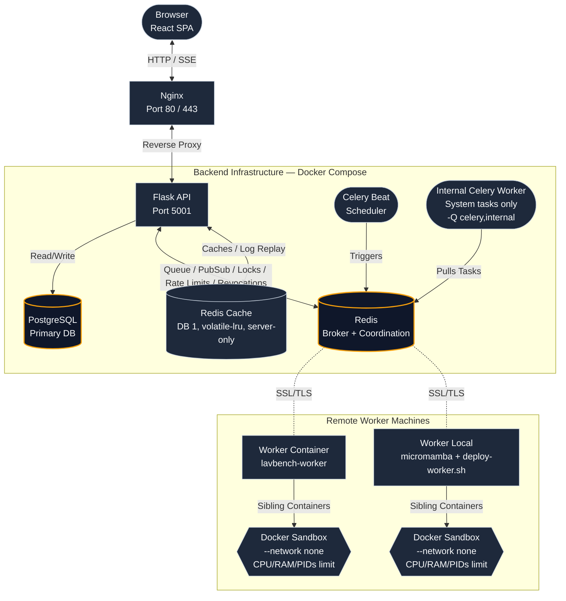

# LavBench

<div align="center">
  <picture>
    <source media="(prefers-color-scheme: dark)" srcset="docs/source/_static/brand_logo_dark.svg">
    <source media="(prefers-color-scheme: light)" srcset="docs/source/_static/brand_logo.svg">
    
  </picture>
</div>

<p align="center">
  <a href="LICENSE"></a>
  <a href="https://github.com/delyan-boychev/lavbench/actions/workflows/ci.yml"></a>
</p>

**LavBench** derives its name from the "Lav" (Lion), a proud national symbol of Bulgaria.

LavBench is a secure platform for machine learning competitions. Competitors submit Jupyter notebooks or prediction files; their code runs in isolated Docker sandboxes with no network and strict resource limits, and the scores stream to live leaderboards. The jury reviews anonymised submissions, and the administrator runs the whole competition from the web interface, in English and Bulgarian.

It was created by the Bulgarian AI Olympiad Committee for the national olympiad and the IOAI team selection. Other countries' AI olympiad committees, teams and the IOAI board are welcome to use it and contribute.

## Who Uses It

| Role | What they do | Guide |
| :--- | :--- | :--- |
| Competitors | Submit notebooks or files, follow their runs and the leaderboard | [Competitor guide](guides/en/competitor_guide.md) |
| Jury | Monitor submissions, review anonymised work, award manual points | [Jury guide](guides/en/jury_guide.md) |
| Administrator | Set up competitions, tasks, evaluators, workers, backups and accounts | [Admin guide](guides/en/admin_guide.md) |

The guides are also available in Bulgarian under [`guides/bg/`](guides/bg/).

## Features

- **Sandboxed runs:** every submission runs in its own container with `--network none`, all capabilities dropped, a read-only root file system and CPU, memory and process limits.
- **Anonymous review:** competitors appear to the jury under aliases until the results are final, and personal data is encrypted at rest.
- **Live leaderboards:** scores, build status and run logs reach the browser as they happen.
- **Stages and deadlines:** multi-stage competitions with their own windows, grace periods, daily quotas and final-submission selection.
- **44 built-in metrics and custom evaluators** for tasks the built-in metrics do not cover.
- **Remote workers:** evaluation runs on separate CPU and GPU machines that authenticate with their own keys.
- **Backups and audit log:** scheduled database and full backups, and a log of every administrative change with the reason for it.

## How It Works



## Requirements

- A Linux server with Docker Engine and Docker Compose 2.24 or later.
- [micromamba](https://mamba.readthedocs.io/en/latest/installation/micromamba-installation.html), Python 3.12 and Node.js 26 for the setup scripts (`.python-version`, `.nvmrc`).
- One or more evaluation workers: Linux machines with Docker; GPU workers also need the NVIDIA driver and the NVIDIA Container Toolkit.

## Deploy

```bash
make setup-server     # check prerequisites, create the environment, generate keys and .env
make deploy-server    # build and start the Docker Compose stack
make setup-admin      # create the administrator account
make setup-worker     # on each worker machine, then: make deploy-worker
```

`make setup-server` generates the required secrets (`SECRET_KEY`, `ENCRYPTION_KEY`, `POSTGRES_PASSWORD`, `WORKER_PUBLIC_KEYS_JSON`, `WORKER_CAPABILITY_SECRET`, `EVALUATION_SPLIT_SECRET`) and `make setup-worker` the worker's `WORKER_ID` and `WORKER_PRIVATE_KEY`. Every other setting is listed with its default in [`.env.example`](.env.example); `make edit` changes them later. Workers and their keys are described in [section 8 of the admin guide](guides/en/admin_guide.md#8-worker-authentication-cli-setup-and-sse-telemetry), and the full design in the [architecture document](docs/source/architecture.md).

## Documentation

- User guides: [competitor](guides/en/competitor_guide.md), [jury](guides/en/jury_guide.md), [administrator](guides/en/admin_guide.md).
- [Architecture](docs/source/architecture.md): pipeline, sandbox, workers and security.
- [API reference](docs/source/api/spec.json): the OpenAPI document, rendered in the Sphinx documentation (`make docs`).
- [Documentation index](docs/README.md): every document and how to build the docs.

## Contributing and Security

- [CONTRIBUTING.md](CONTRIBUTING.md): local setup, conventions and the checks to run before a pull request.
- [SECURITY.md](SECURITY.md): how to report a vulnerability privately and which versions get fixes.
- [Code of Conduct](CODE_OF_CONDUCT.md): the standard for everyone taking part.

## License

Released under the [GNU Affero General Public License v3.0](LICENSE).
